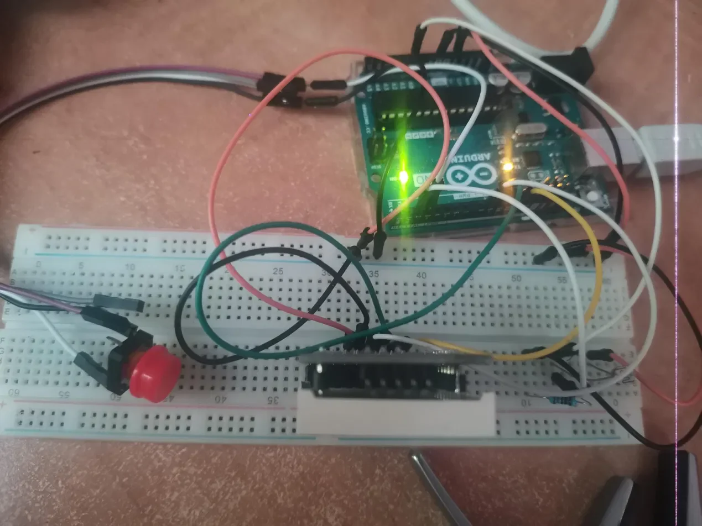

# FlashCounter

This is a simple Arduino flash counter. It consists of an 8x8 LED matrix, a photoresistor and a button that controls the brightness.

## Build steps
1. Install the Arduino IDE and the LedControl library (Library Manager).
2. Open `flash_counter/flash_counter.ino`, select Arduino Uno and its port.
3. Click Upload. Open Serial Monitor at 9600 baud to see the log.

## Timer config
Timer1, CTC mode, prescaler 256, `OCR1A = 624`.

16 MHz / 256 = 62 500 counts/s, so 625 counts = 10 ms per interrupt.

## ISR roles
TIMER1_COMPA_vect, every 10 ms, tick = true

flashISR (INT0, D2), RISING on light flash, flashed = true

buttonISR (INT1, D3), FALLING on button press, pressed = true

ISRs only set flags.

## EEPROM layout
EEPROM is one struct, stored as continuous bytes from address 0. It consists of:

magic 0xF1A5, 2 bytes

version 3, 1 byte

count, 4 bytes

brightness, 1 byte

If the magic or version doesn't match, defaults are written. Saved only when the data changed, and put() only rewrites the bytes that are different.

## Wiring

Matrix: VCC 5V, GND GND, DIN D9, CS D10, CLK D11

Photoresistor: one leg to 5V, other leg to D2 and A0, plus a 10 kΩ resistor from that leg to GND

Button: one leg to D3, the diagonal leg to GND
